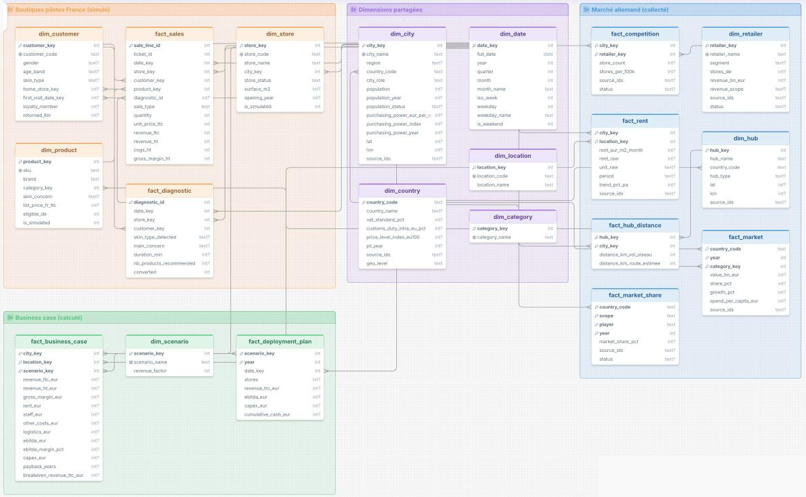
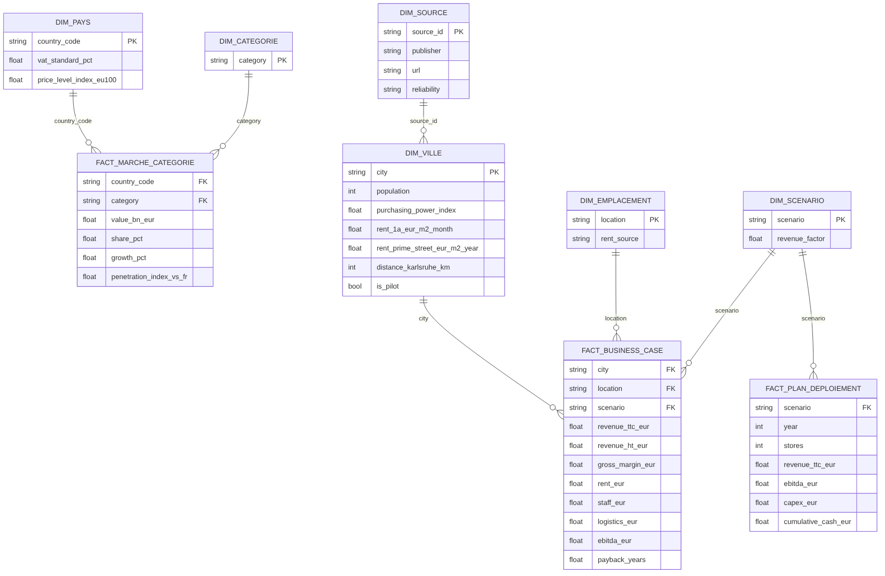

# L'Oréal : boutiques diagnostic de peau en Allemagne

Projet du module Data Analytics, Eugenia School. **Question du Comex : L'Oréal doit-il lancer un réseau de boutiques spécialisées dans le diagnostic de peau en Allemagne d'ici 2029 ? Est-ce réalisable et rentable ?**

**Réponse : Go conditionnel, limité à 3 boutiques pilotes en 2027**, en rue commerçante 1a. Les 3 pilotes remboursent leur investissement en 3,9 ans (scénario réaliste). Pas d'engagement à 15 boutiques à ce stade : le plan 3 → 8 → 15 n'est pas remboursé fin 2031 dans nos scénarios. La vague 2028 ne se déclenche que si les pilotes atteignent environ 9 600 € de CA par m², soit 22 % de plus que l'estimation réaliste. Le détail est dans la [synthèse IA](docs/synthese_ia.md).

**Équipe** : Hanine Bendiab, Hugo Fissier, Nathan Skwarek, Gaspard Leroux, Lili Sheppard

## 1. Présentation de l'entreprise

| | |
|---|---|
| Entreprise | L'Oréal, n°1 mondial de la beauté, coté au CAC 40 |
| Activité en France | Plus de 50 marques, 11 usines, environ 15 500 salariés directs ([rapport annuel 2024](https://www.loreal-finance.com/fr/rapport-annuel-2024/loreal-dans-le-monde/france/)) |
| Concept | Boutiques en propre **spécialisées dans le diagnostic de peau**, qui recommandent les soins des marques du groupe |
| Réseau France | **X = 20 boutiques pilotes** en France (hypothèse du projet, base interne simulée) |
| Catalogue | Environ 480 références de soin : La Roche-Posay, CeraVe, Vichy, SkinCeuticals, Kiehl's, Lancôme Skincare |
| Plan étudié | 3 boutiques en 2027, 8 en 2028, 15 en 2029 |
| Pays ciblé | **Allemagne**, dans le cadre de la stratégie 2027-2029 |

L'Oréal est un fabricant, qui vend surtout via des distributeurs. Le projet étudie donc un **nouveau réseau de boutiques en propre**, reformulation validée par le professeur. L'Allemagne est un choix logique : le groupe y est déjà n°1 de la beauté et possède une usine à Karlsruhe.

## 2. Cadrage & dictionnaire de données

### Les 5 axes d'analyse

| Axe | KPI | Valeur | Ce qu'il décide |
|---|---|---|---|
| Marché & potentiel | Croissance annuelle du marché | DE +6,3 % / FR +1,6 % (2025) | Plafond de CA accessible |
| | Part de marché d'un concurrent | dm = 46,8 % des ventes des drogeries | Intensité concurrentielle |
| | Dépense en soins de la peau par habitant | DE 48 € / FR 66 € (−27 %) ; croissance du soin DE +11,1 % | Potentiel du concept |
| Prix & marges | Indice de prix relatif des soins du catalogue (DE vs FR) | 106,7 TTC au prix public conseillé français (117,9 aux prix pratiqués) ; relevé de 8 soins des 6 marques, pondéré par marque. Eurostat, toute la consommation : 98,2 | Positionnement prix |
| | Marge brute estimée après taxes | 70,3 % du CA HT ; +0,8 % de CA HT grâce à la TVA à 19 % | Rentabilité unitaire |
| Réseau & implantation | Densité concurrentielle | Villes pilotes : 6,9 drogeries (dm, Rossmann, Müller) et 21 pharmacies pour 100 000 hab. (OpenStreetMap) ; 6,2 au niveau national | Rythme de déploiement |
| | Coût moyen au m² | 20 – 45 €/m²/mois en rue 1a ; 120 – 320 €/m²/mois sur artère n°1 | Coût de déploiement |
| Opérations & logistique | Distance moyenne au hub | 271 km depuis Karlsruhe pour les 3 pilotes (776 km depuis l'usine de Vichy, 903 km depuis La Roche-Posay) | Chaîne d'approvisionnement |
| | Droits de douane / taxes | 0 % de douane, TVA 19 % | Surcoûts à l'import |
| Assortiment | Indice de pénétration des catégories (DE / FR) | Soins de la peau 0,71 ; capillaires 1,70 | Assortiment ciblé ou complet |
| | % du catalogue soin France éligible | 94,6 % | Déploiement du catalogue |
| Rentabilité (synthèse) | Délai de retour sur investissement des 3 pilotes | 3,9 ans (réaliste) ; 10,3 ans (pessimiste) ; 2,7 ans (optimiste) | Go sur les pilotes |
| | Trésorerie cumulée fin 2031 du plan 15 boutiques | −3,5 M€ (réaliste) ; −1,1 M€ (optimiste) | Go / No-Go sur le passage à l'échelle |
| | CA par m² nécessaire pour rembourser le plan | ≈ 9 600 € (estimation réaliste : 7 880 €) | Seuil de passage à l'échelle |

### Dictionnaire des données (tables Gold)

| Champ | Table | Type | Description | Règle / formule | Source |
|---|---|---|---|---|---|
| `market_value_bn_eur` | fact_marche_categorie | décimal | Ventes de la catégorie au prix de détail | — | Cosmetics Europe 2025 |
| `share_pct` | fact_marche_categorie | décimal | Poids de la catégorie dans le marché du pays | valeur catégorie / marché pays | Cosmetics Europe 2025 |
| `penetration_index_vs_fr` | fact_marche_categorie | décimal | Poids relatif d'une catégorie en Allemagne | part DE / part FR | Calculé |
| `purchasing_power_index` | dim_ville | décimal | Pouvoir d'achat par habitant, Allemagne = 100 | — | NIQ-GfK 2025 |
| `rent_1a_eur_m2_month` | dim_ville | décimal | Loyer médian en rue commerçante 1a | médiane 2024/25 | IW Köln 2026 |
| `rent_prime_street_eur_m2_month` | dim_ville | décimal | Loyer de l'artère n°1 de la ville, en €/m²/mois | — | BNP Paribas Real Estate S1 2026 |
| `drogeries_per_100k` | dim_ville | décimal | dm + Rossmann + Müller pour 100 000 habitants | idem pour `parfumeries_`, `pharmacies_`, `instituts_per_100k` | OpenStreetMap |
| `competition_status` | dim_ville | texte | « mesuré » ou « estimé » | estimé = densité moyenne des 5 villes mesurées | Calculé |
| `distance_karlsruhe_km` | dim_ville | entier | Distance routière estimée depuis l'usine de Karlsruhe | vol d'oiseau × 1,25 | Calculé |
| `revenue_ttc_eur` | fact_business_case | décimal | CA annuel potentiel d'une boutique | densité FR × surface × (dépense soin/hab DE ÷ FR) × (indice prix DE ÷ FR) × indice pouvoir d'achat ÷ 100 × facteur scénario | Calculé |
| `revenue_ht_eur` | fact_business_case | décimal | CA hors taxe | CA TTC / 1,19 | Calculé |
| `gross_margin_eur` | fact_business_case | décimal | Marge brute | CA HT × taux de marge brute France | Calculé |
| `ebitda_eur` | fact_business_case | décimal | Résultat d'exploitation annuel | marge brute − loyer − personnel − autres charges − logistique | Calculé |
| `payback_years` | fact_business_case | décimal | Années pour rembourser l'investissement | investissement / EBITDA (vide si EBITDA ≤ 0) | Calculé |
| `cumulative_cash_eur` | fact_plan_deploiement | décimal | Trésorerie cumulée du plan | somme des EBITDA − investissements, avec montée en charge 70 % / 90 % / 100 % | Calculé |
| `diagnostics_per_year` | boutiques_france (Silver) | entier | Diagnostics de peau réalisés par boutique | — | Base interne simulée |
| `diag_conversion_rate` | boutiques_france (Silver) | décimal | Part des diagnostics suivis d'un achat | achats après diagnostic / diagnostics | Base interne simulée |

**Termes métier** : *rue 1a* = meilleure rue commerçante d'une ville, hors artère n°1 ; *artère n°1 (flagship)* = l'emplacement le plus cher de la ville (Kaufingerstraße à München, Königsallee à Düsseldorf…) ; *drogerie* = chaîne de type dm ou Rossmann, premier canal de vente des cosmétiques en Allemagne.

### Entrepôt de données : modèle en constellation

Les tables Gold ci-dessus servent la restitution. La base de référence est l'**entrepôt** (`data/warehouse/`, schéma [`sql/schema.sql`](sql/schema.sql)) : **11 tables de faits**, chacune à son grain, reliées par **12 dimensions partagées** avec des clés de substitution.

| Famille | Tables de faits (grain) |
|---|---|
| Boutiques pilotes France (simulé) | `fact_diagnostic` (un diagnostic), `fact_sales` (une ligne de ticket : après diagnostic, rachat ou sans diagnostic) |
| Marché allemand (collecté) | `fact_market` (pays × année × catégorie), `fact_market_share`, `fact_market_indicator` (indicateurs des panels NielsenIQ, Circana, IKW), `fact_competition` (ville × enseigne), `fact_rent` (ville × emplacement), `fact_price` (produit × pays), `fact_hub_distance` (hub × ville) |
| Business case (calculé) | `fact_business_case` (ville × emplacement × scénario), `fact_deployment_plan` (scénario × année) |

Les dimensions conformes (`dim_city`, `dim_location`, `dim_scenario`, `dim_category`, `dim_country`, `dim_date`) permettent de croiser l'activité des pilotes avec le marché allemand et le business case. Le détail des pilotes (105 000 diagnostics, 572 000 lignes de vente en 2025) est calé boutique par boutique sur `boutiques_france.csv` : le CA, la conversion et le rachat agrégés ne changent pas, donc les KPIs non plus.



*Diagramme DrawSQL des 20 tables principales, par famille. Absentes du diagramme (limite de 20 tables de la version gratuite), mais présentes dans le schéma SQL : `fact_price`, `fact_market_indicator`, `dim_source`, `ref_hypotheses`, `ref_reglementation`.*

- Choix du modèle et diagramme : [`docs/modele/schema.md`](docs/modele/schema.md)
- Dictionnaire complet (termes métier, 12 règles de gestion, colonnes, KPIs) : [`docs/modele/dictionnaire-de-donnees.md`](docs/modele/dictionnaire-de-donnees.md)
- Contrôles à chaque construction (clés étrangères, calage, calculs) : `data/warehouse/rapport_qualite.md` et `tests/`

## 3. Architecture & choix des sources

```text
data/raw/externe  ──┐
                    ├──> src/build.py ──> data/gold (modèle en étoile) ──> dashboard + docs/kpis.json ──> src/ai_synthesis.py ──> docs/synthese_ia.md
data/raw/interne  ──┘    (contrôles)
```



Le modèle Gold a **quatre tables de faits** : `fact_business_case` (grain : une ville × un emplacement × un scénario), `fact_plan_deploiement` (grain : une année × un scénario), `fact_concurrence_ville` (grain : une ville × une enseigne) et `fact_marche_categorie` (grain : un pays × une catégorie). Toutes les tables pointent vers `dim_source`, ce qui permet de remonter à l'origine de chaque chiffre.

| Source | Type | Données utilisées | Pourquoi elle |
|---|---|---|---|
| [Cosmetics Europe 2025](https://via.ritzau.dk/files/13559575/15049655/464298/da) | Fédération professionnelle | Taille, croissance et catégories du marché DE et FR | Seule source qui compare tous les pays européens avec la même méthode |
| [Statistics Norway / Eurostat](https://www.ssb.no/en/priser-og-prisindekser/konsumpriser/statistikk/sammenlikning-av-prisniva-i-europa) | Open data officielle | Niveau des prix 2025 (DE 108,3 ; FR 110,3) | Comparaison officielle des prix entre pays |
| [NIQ-GfK Kaufkraft 2025](https://nielseniq.com/global/de/news-center/2025/kaufkraft-der-deutschen-erhoeht-sich-2025-was-den-anstieg-der-verbraucherpreise-jedoch-nicht-kompensiert/) | Étude de marché | Pouvoir d'achat des 8 grandes villes | Référence du commerce allemand pour choisir une implantation |
| [IW Köln 2026](https://www.iwkoeln.de/fileadmin/user_upload/Studien/Report/PDF/2026/IW-Report_2026-Mietentwicklung-Einzelhandel.pdf) | Institut de recherche | Loyers en rue 1a | Médianes ajustées de la qualité, pas des annonces isolées |
| [BNP Paribas Real Estate, S1 2026](https://www.realestate.bnpparibas.de/sites/default/files/document/2026-07/bnppre-top-retailm%C3%A4rkte-2026-h1-inkl-b-standorte.pdf) | Conseil immobilier | Loyers des artères n°1 des 8 villes | Seule source couvrant les 8 villes avec la même méthode ; recoupe Cushman & Wakefield à München (320 €/m²/mois) |
| [OpenStreetMap](https://www.openstreetmap.org) (API Overpass) | Open data | Magasins concurrents par ville | Seule source gratuite au niveau ville, automatisable (`src/collect/collect_osm.py`) |
| [Circana](https://www.circana.com/post/beauty-market-trends-in-europe-mid-range-brands-are-gaining-momentum), [NielsenIQ](https://nielseniq.com/wp-content/uploads/sites/4/2026/04/Global-Beauty-Views-2026.pdf) | Panels de distribution | Tendances prestige / milieu de gamme, e-commerce | Références du secteur ; seules les publications gratuites sont utilisées |
| [Sonko Consulting](https://www.sonko-consulting.com/guides/german-beauty-retailers), [Douglas](https://douglas.group/fileadmin/user_upload/20251218_DOUGLAS_Group_PM_Q4_2024-25.pdf), [Handelsdaten](https://www.handelsdaten.de/drogerien-und-drogeriemarkte/2024-marktanteile-umsatzstaerkste-drogeriemaerkte-deutschland), [IKW](https://www.ikw.org/en/market-data) | Conseil, rapport financier, statistiques | Concurrents, magasins, parts de marché, canaux | Croisement de plusieurs sources pour la concurrence |
| [L'Oréal, rapports annuels](https://www.loreal-finance.com/fr/rapport-annuel-2023/loreal-dans-le-monde/dach/) | Rapport annuel | Usine de Karlsruhe, position n°1 en Allemagne | Source primaire de l'entreprise |
| [IHK Frankfurt](https://www.frankfurt-main.ihk.de/recht/uebersicht-alle-rechtsthemen/lebensmittel-und-bedarfsgegenstaenderecht/kosmetik-5195262), Règlement (CE) 1223/2009 | Réglementation | Étiquetage, emballages, conformité | Sources officielles |
| **Base interne simulée** | Données simulées | 20 boutiques France (ventes, diagnostics, conversion, rachats), catalogue soin, hypothèses de coûts | L'Oréal ne publie pas ces données : à remplacer par les vraies |

La liste complète, avec un niveau de fiabilité pour chaque source, est dans [`data/raw/sources.csv`](data/raw/sources.csv).

**Limites assumées** : la concurrence par ville est mesurée dans OpenStreetMap pour 5 villes ; Hamburg, Berlin et Leipzig sont estimées avec la densité moyenne des 5 autres (serveurs OSM saturés), et les magasins Douglas y sont probablement sous-comptés. La base France est simulée, avec une graine fixe pour être reproductible. Les populations sont officielles (Destatis, 31/12/2025). L'indice de prix Eurostat porte sur toute la consommation des ménages ; le business case utilise donc un relevé de 8 soins couvrant les 6 marques du catalogue (12/11/2026) : pondérés par marque, les soins sont 6,7 % plus chers en Allemagne qu'au prix public conseillé français, et 17,9 % plus chers qu'aux prix pratiqués par les pharmacies en ligne françaises, qui remisent fortement. Le business case retient le prix public conseillé, plus proche du prix d'une boutique L'Oréal en propre (référence prudente). L'écart vient surtout de CeraVe (115) et SkinCeuticals (135) ; Lancôme est moins cher en Allemagne (94), Kiehl's, Vichy et La Roche-Posay sont au même niveau. Le nombre de magasins Douglas n'est publié que pour le segment Allemagne-Autriche-Suisse-Pays-Bas (486). Les parts de marché de L'Oréal et de Rossmann ne sont pas publiques (données NielsenIQ / Circana payantes).

## 4. Plan d'organisation & roadmap

| Rôle | Membre | Responsabilités |
|---|---|---|
| Cheffe de projet et business case | Hanine Bendiab | Cadrage, lien avec le professeur, recommandation Go / No-Go |
| Collecte des données marché et concurrence | Hugo Fissier | Sources marché, villes, concurrents, loyers |
| Modélisation et pipeline | Nathan Skwarek | Modèle en étoile, dictionnaire, code, données internes simulées |
| KPIs et rentabilité | Gaspard Leroux | Indice prix, marges après TVA, coûts, scénarios |
| Dataviz et brique IA | Lili Sheppard | Dashboard, synthèse IA |

**Méthode** : cadrage des 5 axes avec la grille de KPIs, une branche Git par personne fusionnée dans `develop`, puis dans `main` une fois les contrôles du pipeline validés.

**Next steps** (recommandations post-étude) :
1. Ouvrir 3 boutiques pilotes en 2027 (München, Düsseldorf, Frankfurt am Main), en rue 1a uniquement.
2. Déclencher la vague 2028 seulement si les pilotes atteignent ≈ 9 600 € de CA par m² sur 12 mois et ≈ 60 % de conversion des diagnostics.
3. Remplacer la base simulée par les chiffres réels des boutiques France, puis refaire tourner le pipeline.
4. Étudier une alternative moins coûteuse : des corners diagnostic chez dm, Rossmann ou en pharmacie. En Allemagne, La Roche-Posay, CeraVe, Vichy et SkinCeuticals passent par les pharmacies (dm ne les vend qu'en ligne, via dm-med) : ce sont les pharmacies, plus que les drogeries, que des boutiques en propre concurrenceraient.
5. Élargir le relevé de prix (10 à 20 références par marque) : aux prix pratiqués, le retour sur investissement des pilotes tomberait autour de 3 ans.
6. Mesurer la concurrence à Hamburg, Berlin et Leipzig (relancer `collect_osm.py`), étiquetage en allemand et enregistrement LUCID.

## 5. Stack technique

| Étape | Outil |
|---|---|
| Collecte | Recherche documentaire, open data, CSV sourcés |
| Transformation et contrôles | Python 3, pandas |
| Modélisation | Entrepôt en constellation : schéma SQL (`sql/schema.sql`), base SQLite et CSV, diagramme Mermaid et DrawSQL ; tables de restitution Gold en CSV |
| Base interne détaillée et entrepôt | Python standard (`src/simulate_transactions.py`, `src/build_warehouse.py`), sans dépendance |
| Tests | `unittest` (`tests/`) : clés étrangères, calage sur les agrégats, calculs |
| Brique IA | API Claude (Anthropic) via `src/ai_synthesis.py`, et synthèse à la demande dans le dashboard |
| Restitution | Dashboard interactif (Claude Artifact), slides |
| Versioning | Git / GitHub |

## Lancer le projet

```bash
pip install -r requirements.txt
python -m src.simulate_internal   # régénère la base interne simulée
python -m src.simulate_transactions   # détail : diagnostics, ventes, rachats (calés sur la base simulée)
python -m src.build               # modèle en étoile + KPIs (s'arrête si un contrôle échoue)
python -m src.build_warehouse     # entrepôt en constellation + rapport qualité (data/warehouse/)
python -m unittest discover tests # contrôles de l'entrepôt
python -m src.ai_synthesis        # synthèse IA (nécessite ANTHROPIC_API_KEY)
```

Le détail des pilotes et l'entrepôt (environ 160 Mo) ne sont pas versionnés : ils se régénèrent à l'identique avec les commandes ci-dessus, sauf `data/warehouse/rapport_qualite.md`.
