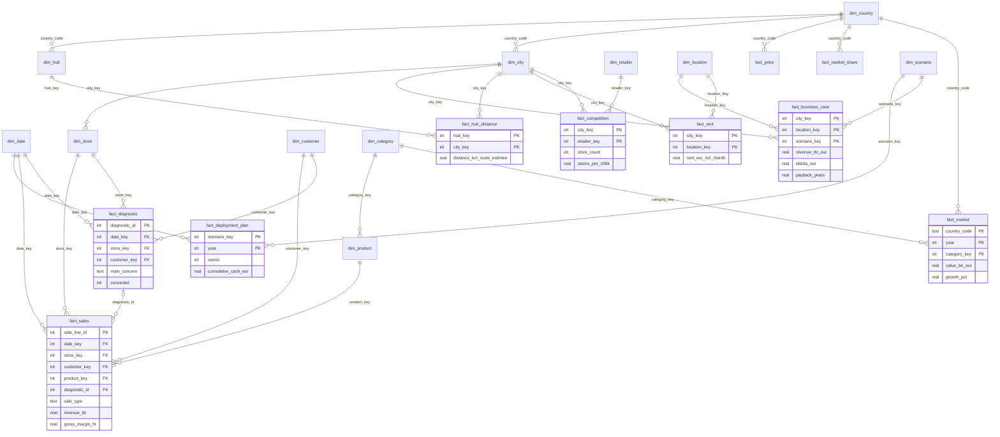

# Modèle de données : constellation de faits

Schéma SQL de référence : [`sql/schema.sql`](../../sql/schema.sql). Construit par `src/build_warehouse.py` dans `data/warehouse/` (une table CSV par table, plus `warehouse.sqlite`). Dictionnaire complet : [`dictionnaire-de-donnees.md`](dictionnaire-de-donnees.md).

## Pourquoi une constellation

La question du Comex croise deux mondes qui n'ont pas le même grain :

- l'activité **interne** des 20 boutiques pilotes en France : un diagnostic, une ligne de ticket ;
- le **marché allemand** vu de l'extérieur : un pays × une catégorie, une ville × une enseigne, une ville × un emplacement ;
- les **résultats du business case** : une boutique type × un scénario, une année du plan × un scénario.

Une seule table de faits ne peut pas porter ces grains. Le modèle a donc **10 tables de faits**, chacune à son grain, reliées par **12 dimensions partagées** (conformes). Ce sont ces dimensions qui permettent de croiser les mondes :

| Dimension conforme | Relie |
|---|---|
| `dim_city` | boutiques pilotes, villes cibles, concurrence, loyers, distances aux hubs, business case |
| `dim_location` | loyers relevés (`fact_rent`) et business case (`fact_business_case`) |
| `dim_scenario` | business case et plan de déploiement |
| `dim_category` | ventes des pilotes (via `dim_product`) et marché par catégorie |
| `dim_country` | TVA, douane, niveau des prix, marché, relevé de prix |
| `dim_date` | diagnostics, ventes, plan de déploiement |

Deux liens restent en flocon, assumés : `dim_store → dim_city → dim_country` et `dim_product → dim_category`. Les recopier dans chaque fait ajouterait des colonnes sans rien apporter au dashboard.

## Ce qui change par rapport au premier modèle (Gold)

Le premier modèle (`docs/img/modele_etoile.png`) reste celui des tables de restitution `data/gold/`, lues par le dashboard. L'entrepôt le reprend et le complète :

1. **Clés de substitution** entières au lieu de jointures sur des libellés (« Rue commerçante 1a (médiane) », « Frankfurt am Main »).
2. **Une dimension date**, absente du premier modèle.
3. **Loyers et distances sortis de la dimension ville** et rangés dans des faits (`fact_rent`, `fact_hub_distance`) : ce sont des mesures, pas des attributs.
4. **Le détail des boutiques pilotes** : diagnostics, ventes et rachats, au grain de la transaction, calés boutique par boutique sur `boutiques_france.csv`. Le CA, la conversion et le rachat agrégés sont identiques, donc les KPIs du business case ne changent pas.
5. **Les faits qui manquaient** : concurrence par ville, parts de marché, relevé de prix, distances aux deux hubs.

## Diagramme

Rendu automatique dans GitHub. Pour DrawSQL : Import, PostgreSQL, coller `sql/schema.sql`.



## Chaîne de traitement

```text
src/simulate_internal.py      → data/raw/interne (agrégats par boutique et marque, catalogue)
src/simulate_transactions.py  → data/raw/interne (diagnostics, ventes, clientes), calés sur les agrégats
src/collect/collect_osm.py    → data/raw/externe/concurrents_villes.csv
src/build.py                  → data/gold (business case, plan, KPIs, dashboard)
src/build_warehouse.py        → data/warehouse (entrepôt en constellation + rapport qualité)
python -m unittest discover tests
```
